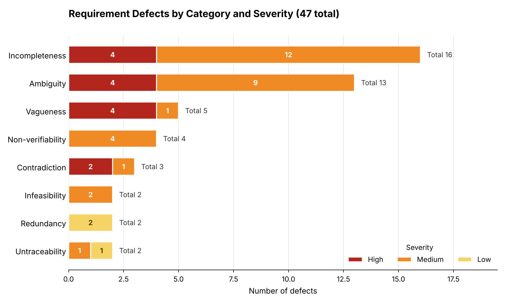

# Defect Summary (Task 2)

Source: `defect-logs/defect-log.md` (47 defects, 12 cross-requirement).

## Counts by category and severity

| Category | High | Medium | Low | **Total** |
|----------|-----:|-------:|----:|----------:|
| Ambiguity | 4 | 9 | 0 | **13** |
| Vagueness | 4 | 1 | 0 | **5** |
| Incompleteness | 4 | 12 | 0 | **16** |
| Contradiction | 2 | 1 | 0 | **3** |
| Non-verifiability | 0 | 4 | 0 | **4** |
| Redundancy | 0 | 0 | 2 | **2** |
| Infeasibility | 0 | 2 | 0 | **2** |
| Untraceability | 0 | 1 | 1 | **2** |
| **Total** | **14** | **30** | **3** | **47** |

## Chart

*Figure 1. Number of defects per category, split by severity (red = High, orange = Medium, yellow = Low).*

## Defects per requirement

A cross-requirement defect is counted once for each requirement it names.

| Requirement | Defects mentioning it |
|---|---:|
| S1 | 3 |
| S2 | 4 |
| S3 | 7 |
| S4 | 3 |
| S5 | 8 |
| S6 | 4 |
| S7 | 3 |
| S8 | 5 |
| S9 | 5 |
| S10 | 7 |
| S11 | 5 |
| S12 | 5 |

## Observations

- The most common categories are **Incompleteness** (16) and **Ambiguity** (13): the requirements mostly lack detail rather than being wrong.
- There are **3 contradictions**, all cross-requirement: S4 vs. S5, S7 vs. S8, S6 vs. S8.
- **14 High-severity** defects must be resolved before formal modelling (Task 3 onward).
- **S5** (8 defects), **S3** and **S10** (7 each) are the most defect-prone requirements; S5 also has the most High-severity problems (undefined emergency, authority, and recipients).
